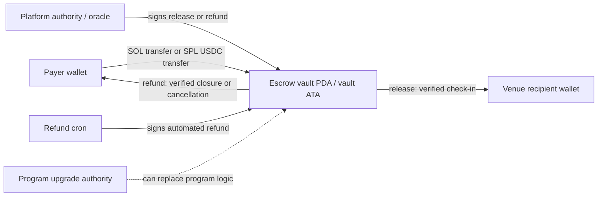
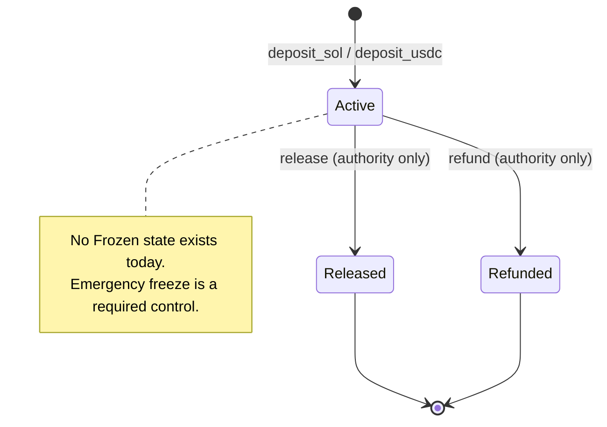

# Escrow Smart Contract Threat Model & Audit Specification (STRIDE)

| Field         | Value                                                                  |
| ------------- | ---------------------------------------------------------------------- |
| Document ID   | `SEC-ESCROW-TM-001`                                                    |
| Issue         | [#7575](https://github.com/SatyamPandey-07/WorkSphere/issues/7575)     |
| Program       | `programs/worksphere-escrow/src/lib.rs`                                |
| Client        | `src/lib/solana/escrowClient.ts`, `src/lib/solana/solanaPayEscrow.ts`  |
| Payment API   | `src/app/api/pay/solana/route.ts`                                      |
| Refund worker | `src/workers/escrowMonitorWorker.ts`, `src/app/api/cron/escrow-refund` |
| Framework     | Anchor `0.30.1`, `anchor-spl 0.30.1`, SPL Token                        |
| Status        | Draft for security review                                              |
| Last updated  | 2026-11-14                                                             |

---

## Table of Contents

1. [Executive Summary](#1-executive-summary)
2. [System Model and Trust Boundaries](#2-system-model-and-trust-boundaries)
3. [Instruction Inventory](#3-instruction-inventory)
4. [Threat Modeling Method](#4-threat-modeling-method)
5. [Exhaustive STRIDE Matrix](#5-exhaustive-stride-matrix)
6. [Detailed Threat Analysis and Defenses](#6-detailed-threat-analysis-and-defenses)
7. [Applied Defenses and Residual Gaps](#7-applied-defenses-and-residual-gaps)
8. [Emergency Freeze and Incident Response](#8-emergency-freeze-and-incident-response)
9. [Client and Backend Verification Controls](#9-client-and-backend-verification-controls)
10. [Automated Security Testing and Fuzzing](#10-automated-security-testing-and-fuzzing)
11. [Independent Audit Specification](#11-independent-audit-specification)
12. [Acceptance Traceability](#12-acceptance-traceability)
13. [References](#13-references)
14. [Appendix A: Instruction Encodings and Discriminators](#appendix-a-instruction-encodings-and-discriminators)
15. [Appendix B: Error Codes and Configuration](#appendix-b-error-codes-and-configuration)
16. [Appendix C: Glossary](#appendix-c-glossary)

---

## 1. Executive Summary

WorkSphere's desk-booking escrow is a non-custodial Solana Anchor program. A payer deposits SOL or USDC into a per-booking Program Derived Address (PDA); the platform authority/oracle releases the funds to the venue after a verified check-in, or refunds the depositor after a verified venue closure or cancellation. The program exposes four instructions:

- `deposit_sol`
- `deposit_usdc`
- `release`
- `refund`

The on-chain program is intentionally small. The security of the system therefore depends on four things:

1. **Account binding on-chain** — the authority, recipient, depositor, mint, vault token account, and PDA must be the exact accounts the booking agreed to.
2. **Trusted off-chain evidence** — check-in and venue-closure proofs must be server-side, time-bounded, and attributable to the booking, not merely to a user and a venue.
3. **Correct client construction and verification** — the transaction the user signs must call the program, and confirmation must be derived from finalized on-chain state rather than from a client-supplied signature or a single RPC response.
4. **Key and upgrade governance** — a single hot key or a single upgrade authority must not be able to move every vault, and there must be a way to stop settlement during an incident.

The current source already applies several important defenses: Anchor's `init` constraint derives and initializes the PDA from seeds; `Account<EscrowAccount>` enforces program ownership and the Anchor discriminator; the `Active`/`Released`/`Refunded` state machine prevents a second successful settlement; `authority` is a `Signer` on release/refund; and the client refuses to run `release`/`refund` while the program ID is a placeholder.

However, this review identifies material gaps between the intended non-custodial guarantee and the current implementation. The most important findings are summarized below. Each finding is described in detail in later sections.

### 1.1 Key findings

| ID     |     Severity | Finding                                                                                                                                                                                                                                                                                                                                                                                               | Primary evidence                                                                                     |
| ------ | -----------: | ----------------------------------------------------------------------------------------------------------------------------------------------------------------------------------------------------------------------------------------------------------------------------------------------------------------------------------------------------------------------------------------------------- | ---------------------------------------------------------------------------------------------------- |
| ESC-01 | **Critical** | The deposit API does not invoke the Anchor `deposit_sol` / `deposit_usdc` instructions. It builds a System transfer plus a JSON payload addressed to the program ID, so the escrow account is never initialized and a deployed Anchor program will reject the instruction. The user's deposit flow and the settlement flow are therefore disconnected.                                                | `src/lib/solana/escrowClient.ts:159-278`, `src/app/api/pay/solana/route.ts:203-222`                  |
| ESC-02 | **Critical** | `deposit_sol` and `deposit_usdc` accept caller-supplied `authority` and `recipient` accounts with **no constraint** that they are the platform oracle or the venue. A payer can initialize an escrow with themselves as both authority and recipient, then call `release` immediately and recover their deposit after consuming the booking. This defeats the check-in gate.                          | `programs/worksphere-escrow/src/lib.rs:245-296`                                                      |
| ESC-03 | **Critical** | `verifyDeposit` does not verify a USDC token transfer at all: after confirming that the expected payer is a signer, it returns `verified: true` for any transaction, including a zero-value transaction. The SOL branch only checks the vault's lamport delta, not that the payer funded it, so a third party's transfer can be claimed.                                                              | `src/lib/solana/escrowClient.ts:337-423`                                                             |
| ESC-04 |     **High** | The PDA is derived from the raw booking ID string. Solana limits each seed to 32 bytes, but the program accepts booking IDs up to 64 bytes. Any booking ID longer than 32 bytes fails at runtime, and the raw seed provides no domain separation beyond the prefix and no collision-resistant commitment to the booking.                                                                              | `programs/worksphere-escrow/src/lib.rs:6, 19, 250, 274`; `src/lib/solana/escrowClient.ts:839-854`    |
| ESC-05 |     **High** | `release` and `refund` accept `check_in_timestamp` / `closure_timestamp` as arbitrary instruction arguments. The program does not use the Clock sysvar to reject future, stale, or pre-deposit timestamps. A compromised or buggy oracle can produce an unverifiable settlement time.                                                                                                                 | `programs/worksphere-escrow/src/lib.rs:102-166, 170-236`                                             |
| ESC-06 |     **High** | USDC vault and recipient token accounts are unconstrained `Option<Account<TokenAccount>>`. The program does not enforce the canonical USDC mint, the escrow PDA as owner, or the associated token address. A caller can substitute a different mint or token account.                                                                                                                                 | `programs/worksphere-escrow/src/lib.rs:267-296, 298-350`                                             |
| ESC-07 |     **High** | The hand-built release/refund instructions do not match the Anchor account order. `createReleaseInstruction` places `system_program` where `vault_token_account` is expected and never passes the token accounts at all, so USDC settlement cannot succeed. `buildReleaseTransaction` also derives the PDA with the default program ID rather than the caller-supplied one.                           | `src/lib/solana/escrowClient.ts:888-1019`                                                            |
| ESC-08 |     **High** | `releaseEscrow` and `refundEscrow` record `RELEASED` / `REFUNDED` in an in-memory ledger **before** a transaction is signed or broadcast, and return the base64 serialized transaction as `signature`. The API then reports success. A crash, restart, or failed wallet signature leaves a false settlement state and no durable reconciliation record.                                               | `src/lib/solana/escrowClient.ts:1078-1099, 1221-1310`, `src/app/api/pay/solana/route.ts:459-490`     |
| ESC-09 |     **High** | There is no emergency pause, no per-escrow freeze, no multisig authority, and no documented upgrade-authority control. A compromised `SOLANA_ESCROW_AUTHORITY_SECRET_KEY` or program upgrade key can settle or replace the program without a second approver.                                                                                                                                         | `programs/worksphere-escrow/src/lib.rs` (entire program); `src/lib/solana/escrowClient.ts:1461-1471` |
| ESC-10 |   **Medium** | Escrow accounts are never closed. Rent stays locked after settlement, there is no minimum deposit, and an attacker can create many low-value escrows. If rent or fees are ever subsidized by the platform, this becomes a direct drain.                                                                                                                                                               | `programs/worksphere-escrow/src/lib.rs:124-128, 192-197, 356-371`                                    |
| ESC-11 |   **Medium** | The check-in proof is not bound to the booking. `verifyCheckInForBooking` searches for any unexpired check-in for the same user and venue, not the booking's date, time, seat, or confirmation ID.                                                                                                                                                                                                    | `src/lib/solana/escrowClient.ts:1111-1158`                                                           |
| ESC-12 |   **Medium** | Wallet addresses, booking IDs, amounts, and timing are written to public memos and events. Solana is a transparent ledger; this creates linkability and long-lived disclosure of customer behavior.                                                                                                                                                                                                   | `src/lib/solana/escrowClient.ts:179-193, 244-264`; `programs/worksphere-escrow/src/lib.rs:390-413`   |
| ESC-13 |     **High** | The release/refund API falls back to a Clerk `userId` for `authorityWallet` and to the authority wallet for the recipient/depositor. A Clerk ID is not a Solana public key, and the venue/depositor are not the authority. If `ESCROW_AUTHORITY_WALLET` is unset, settlement fails at `new PublicKey(...)`; if set, funds can be directed to the wrong account or the on-chain recipient check fails. | `src/app/api/pay/solana/route.ts:461-467, 579-586`                                                   |

> Deployment note: while `NEXT_PUBLIC_ESCROW_PROGRAM_ID` is unset or equal to the System program ID, `isPlaceholderProgramId()` makes `releaseEscrow` and `refundEscrow` throw. That is a useful fail-safe, but it does not mitigate ESC-01, ESC-02, ESC-03, or the client verification gaps once the program is deployed and configured. The threat model assumes the program is live.

### 1.2 Security objectives

| Objective         | Required property                                                                                                                                                                      |
| ----------------- | -------------------------------------------------------------------------------------------------------------------------------------------------------------------------------------- |
| **Custody**       | Funds in the vault can only move to the venue recipient on a valid release or back to the original depositor on a valid refund. No admin, relayer, frontend, or RPC can redirect them. |
| **Authorization** | Only the platform authority can release/refund, and only for an escrow whose authority, recipient, and depositor were fixed at deposit time by a trusted source.                       |
| **Integrity**     | A given booking has exactly one escrow, one successful settlement, and one canonical set of accounts. Replays fail.                                                                    |
| **Availability**  | A legitimate payer can deposit and settle without being blocked by a third party, an RPC outage, or account spam.                                                                      |
| **Auditability**  | Every settlement is explainable by on-chain state plus a durable off-chain evidence record. A failure never produces a false "settled" state.                                          |
| **Containment**   | During an incident, an authorized multisig can pause new releases/refunds without moving user funds.                                                                                   |

### 1.3 Scope

In scope:

- The Anchor program in `programs/worksphere-escrow/src/lib.rs` and its Cargo manifest.
- The client-side builders, PDA derivation, deposit verification, release/refund builders, RPC pool, and optimistic reservation state machine in `src/lib/solana/`.
- The `/api/pay/solana` deposit/confirm/release/refund handlers as they relate to escrow integrity.
- The refund cron's signing, persistence, broadcast, and reconciliation behavior as it relates to double-refund and false-state risks.
- Authority key custody, program upgrade authority, and emergency controls.

Out of scope:

- Solana validator consensus, the SPL Token program, the USDC issuer's freeze authority, and wallet software.
- General web application XSS/CSRF/rate limiting, which is covered by [SECURITY_OVERVIEW.md](./SECURITY_OVERVIEW.md).
- The gasless relayer's fee-payer protections, which are covered by [solana-relayer-threat-model.md](./solana-relayer-threat-model.md).
- Physical venue operations, identity verification, and customer support fraud.

### 1.4 Assumptions

1. The Solana runtime enforces account ownership, signer privileges, PDA derivation, and transaction atomicity.
2. `anchor-lang` and `anchor-spl` versions are pinned and reviewed; dependency compromise is handled by supply-chain controls.
3. The USDC mint address is a trusted configuration value, not a user input.
4. The platform's check-in and venue-closure records are authoritative only if they are written by trusted server code, not by the client.
5. RPC providers are **untrusted for correctness**. They may be stale, malicious, or partitioned; on-chain state and independent quorum checks are the source of truth.
6. Booking IDs are opaque, globally unique identifiers created by the platform. The current Prisma model uses `cuid()` (`prisma/schema.prisma`), which is 25 characters and fits a single Solana seed; other ID formats may not.
7. The program is upgradeable unless the upgrade authority is explicitly revoked after audit.

---

## 2. System Model and Trust Boundaries

### 2.1 Actors

| Actor                       | Trust level                              | Capabilities                                                     | Security relevance                                            |
| --------------------------- | ---------------------------------------- | ---------------------------------------------------------------- | ------------------------------------------------------------- |
| Payer / depositor           | Untrusted                                | Signs deposits; supplies wallet address; may control the client  | Can choose accounts and instruction data; may be the attacker |
| Venue recipient             | Semi-trusted                             | Receives released funds                                          | Must be pinned to the booking; cannot change after deposit    |
| Platform authority / oracle | Trusted, high value                      | Signs release/refund; attests check-in/closure                   | Compromise settles all active escrows                         |
| Refund cron                 | Trusted service                          | Holds authority key; signs automated refunds                     | Must be idempotent and crash-safe                             |
| Frontend / API              | Untrusted from the program's perspective | Builds unsigned transactions; verifies deposits                  | Bugs here become deposit/withdrawal bypasses                  |
| RPC provider                | Untrusted                                | Returns account, transaction, and status data                    | Can lie, replay, omit, or rate-limit                          |
| Program upgrade authority   | Critical                                 | Deploys new program code                                         | Can replace all logic and drain vaults                        |
| Multisig / governance       | Trusted, distributed                     | Owns authority and upgrade keys                                  | Must resist single-key compromise                             |
| Attacker                    | Adversarial                              | Can create accounts, spam, front-run, substitute accounts, phish | Exploits every unbound account and every trusted input        |

### 2.2 Asset flow



The vault is a PDA owned by the escrow program for SOL, or an associated token account owned by the escrow PDA for USDC. The program must be the only path that can debit the SOL vault. For USDC, the escrow PDA must be the token account owner and must sign the transfer through CPI seeds.

### 2.3 Escrow state machine



Terminal states are one-way. The program checks `state == Active` before both settlement paths, so a second `release` or `refund` fails. That is the primary replay defense on-chain. It does **not** protect against off-chain duplicate submissions that never reach the chain, or against a false local ledger state.

### 2.4 Trust boundaries

```mermaid
flowchart TB
    subgraph Browser
      W[Wallet extension]
      UI[Next.js client]
    end
    subgraph WorkSphere backend
      API[/api/pay/solana]
      DB[(Prisma / PostgreSQL)]
      CRON[Escrow refund cron]
      ORACLE[Check-in / closure service]
      KEY[(Authority secret manager)]
    end
    subgraph Solana
      RPC[RPC providers]
      PGM[worksphere_escrow program]
      PDA[Escrow PDA + vault ATA]
      TOKEN[SPL Token program]
    end
    UI --> API
    W -->|signed tx| RPC
    API --> DB
    API --> ORACLE
    CRON --> KEY
    CRON --> RPC
    RPC --> PGM
    PGM --> PDA
    PGM --> TOKEN
    API -->|unsigned tx| UI
```

Boundary crossings that matter:

- **Wallet -> chain**: the wallet signs whatever the API or a malicious frontend constructs. The program must validate every account; it cannot assume the API built the transaction correctly.
- **API -> RPC**: RPC responses are not proof. Confirmation must be independently verified and finalized.
- **Oracle -> program**: the authority signature is the only on-chain evidence of check-in/closure. The timestamp and booking binding must be validated by the program or by a signed attestation with a nonce.
- **Cron -> chain**: a crash between signing and broadcast must be reconcilable; a crash after broadcast must not cause a second refund.
- **Upgrade authority -> program**: this is the ultimate privilege boundary. A malicious upgrade bypasses every account constraint.

---

## 3. Instruction Inventory

All four instructions use Anchor's 8-byte discriminator. The account order below is the order the program expects and is significant for hand-built instructions.

### 3.1 `deposit_sol`

Arguments: `booking_id: String`, `amount: u64`.

| Index | Account          | Signer | Writable | Constraint                                                                                 |
| ----: | ---------------- | :----: | :------: | ------------------------------------------------------------------------------------------ |
|     0 | `escrow_account` |   no   |   yes    | `init`, `payer = depositor`, `seeds = [ESCROW_SEED_PREFIX, booking_id.as_bytes()]`, `bump` |
|     1 | `depositor`      |  yes   |   yes    | Pays rent and deposit                                                                      |
|     2 | `recipient`      |   no   |    no    | **Unconstrained** `AccountInfo`                                                            |
|     3 | `authority`      |   no   |    no    | **Unconstrained** `AccountInfo`                                                            |
|     4 | `system_program` |   no   |    no    | `Program<System>`                                                                          |

State written: `booking_id`, `depositor`, `recipient`, `authority`, `amount`, `currency = Sol`, `bump`, `state = Active`, `created_at = Clock::unix_timestamp`.

### 3.2 `deposit_usdc`

Arguments: `booking_id: String`, `amount: u64`.

| Index | Account                   | Signer | Writable | Constraint                                          |
| ----: | ------------------------- | :----: | :------: | --------------------------------------------------- |
|     0 | `escrow_account`          |   no   |   yes    | `init`, `payer = depositor`, same seeds             |
|     1 | `depositor`               |  yes   |   yes    | Pays rent                                           |
|     2 | `depositor_token_account` |   no   |   yes    | `Account<TokenAccount>`; owner not constrained      |
|     3 | `vault_token_account`     |   no   |   yes    | `Account<TokenAccount>`; mint/owner not constrained |
|     4 | `recipient`               |   no   |    no    | **Unconstrained** `AccountInfo`                     |
|     5 | `authority`               |   no   |    no    | **Unconstrained** `AccountInfo`                     |
|     6 | `token_program`           |   no   |    no    | `Program<Token>` (pinned)                           |
|     7 | `system_program`          |   no   |    no    | `Program<System>` (pinned)                          |

State written: same fields, `currency = Usdc`. The USDC transfer uses the depositor as authority, so the SPL Token program requires `depositor_token_account.owner == depositor`; that part is enforced by the token program, but the destination is not.

### 3.3 `release`

Arguments: `booking_id: String`, `check_in_timestamp: i64`.

| Index | Account                   | Signer | Writable | Constraint                                                |
| ----: | ------------------------- | :----: | :------: | --------------------------------------------------------- |
|     0 | `escrow_account`          |   no   |   yes    | `seeds`, `bump = escrow_account.bump`; no `has_one`       |
|     1 | `authority`               |  yes   |    no    | Manually compared to `escrow.authority`                   |
|     2 | `recipient`               |   no   |   yes    | Manually compared to `escrow.recipient`                   |
|     3 | `vault_token_account`     |   no   |   yes    | `Option<Account<TokenAccount>>`; mint/owner unconstrained |
|     4 | `recipient_token_account` |   no   |   yes    | `Option<Account<TokenAccount>>`; mint/owner unconstrained |
|     5 | `token_program`           |   no   |    no    | `Option<Program<Token>>`                                  |
|     6 | `system_program`          |   no   |    no    | `Program<System>`                                         |

Checks: `state == Active`, `booking_id` matches, `authority.key() == escrow.authority`, `recipient.key() == escrow.recipient`. Writes `check_in_verified_at` and `state = Released` before transferring.

### 3.4 `refund`

Arguments: `booking_id: String`, `reason: String`, `closure_timestamp: i64`.

| Index | Account                   | Signer | Writable | Constraint                                          |
| ----: | ------------------------- | :----: | :------: | --------------------------------------------------- |
|     0 | `escrow_account`          |   no   |   yes    | `seeds`, `bump = escrow_account.bump`; no `has_one` |
|     1 | `authority`               |  yes   |    no    | Manually compared to `escrow.authority`             |
|     2 | `depositor`               |   no   |   yes    | Manually compared to `escrow.depositor`             |
|     3 | `vault_token_account`     |   no   |   yes    | `Option<Account<TokenAccount>>`                     |
|     4 | `depositor_token_account` |   no   |   yes    | `Option<Account<TokenAccount>>`                     |
|     5 | `token_program`           |   no   |    no    | `Option<Program<Token>>`                            |
|     6 | `system_program`          |   no   |    no    | `Program<System>`                                   |

Checks: `state == Active`, `booking_id` matches, `authority.key() == escrow.authority`, `depositor.key() == escrow.depositor`. Writes `venue_closed_verified_at` and `state = Refunded` before transferring.

### 3.5 State layout

```rust
pub struct EscrowAccount {
    pub booking_id: String,        // max_len(64)
    pub depositor: Pubkey,
    pub recipient: Pubkey,
    pub authority: Pubkey,
    pub amount: u64,
    pub currency: Currency,        // Sol = 0, Usdc = 1
    pub bump: u8,
    pub state: EscrowState,        // Active = 0, Released = 1, Refunded = 2
    pub created_at: i64,
    pub check_in_verified_at: Option<i64>,
    pub venue_closed_verified_at: Option<i64>,
}
```

There is no `frozen`, `release_deadline`, `booking_hash`, `check_in_hash`, `mint`, or `vault` field. Adding `booking_hash` and `mint` would make the account self-describing and reduce reliance on external derivation.

---

## 4. Threat Modeling Method

The analysis uses **STRIDE**:

| Letter | Category               | Question for this system                                                                         |
| ------ | ---------------------- | ------------------------------------------------------------------------------------------------ |
| S      | Spoofing               | Can an attacker impersonate a payer, authority, recipient, RPC, or transaction?                  |
| T      | Tampering              | Can an attacker alter accounts, seeds, amounts, token mints, instruction data, or program logic? |
| R      | Repudiation            | Can a party deny that a check-in, closure, release, or refund happened?                          |
| I      | Information disclosure | What do wallet addresses, booking IDs, memos, and events reveal, and to whom?                    |
| D      | Denial of service      | Can an attacker block deposits, settlements, refunds, or the cron?                               |
| E      | Elevation of privilege | Can a payer, relayer, operator, or key holder gain authority they should not have?               |

Severity uses likelihood × impact:

| Severity     | Meaning                                                                                                                              |
| ------------ | ------------------------------------------------------------------------------------------------------------------------------------ |
| **Critical** | Direct loss or theft of funds, free service at scale, or total bypass of the check-in gate; exploitable by an unprivileged attacker. |
| **High**     | Loss of funds under realistic conditions, settlement failure, or privilege escalation requiring a compromised service/key.           |
| **Medium**   | Limited loss, denial of service, incorrect audit state, or privacy harm requiring specific conditions.                               |
| **Low**      | Defense-in-depth gap, best-practice deviation, or issue requiring unlikely preconditions.                                            |

Each threat below is mapped to an instruction and to a control. "Present" means the control exists in the current source; "Partial" means it exists but is incomplete; "Missing" means it must be implemented before deployment.

---

## 5. Exhaustive STRIDE Matrix

### 5.1 Spoofing

| ID   | Instruction / surface           | Threat                                                                                                                                            | Impact                                                                                     | Current control                                                                | Residual risk / required action                                                                                                                                                        |
| ---- | ------------------------------- | ------------------------------------------------------------------------------------------------------------------------------------------------- | ------------------------------------------------------------------------------------------ | ------------------------------------------------------------------------------ | -------------------------------------------------------------------------------------------------------------------------------------------------------------------------------------- |
| S-01 | `confirm` API / `verifyDeposit` | Attacker submits a fabricated or unrelated signature; USDC path returns `verified: true` after only checking that the expected payer is a signer. | Free booking; false payment credit.                                                        | `getParsedTransaction`, `meta.err` check, payer signer check.                  | **Critical.** Parse the actual SPL transfer instruction: source owner == payer, destination == canonical vault ATA, mint == USDC, amount >= expected. Reject otherwise.                |
| S-02 | `verifyDeposit` SOL branch      | Attacker claims a third party's transfer to the same vault; only the vault balance delta is checked, not the source.                              | Free booking at another payer's expense.                                                   | Vault delta check.                                                             | **High.** Require a parsed `system_instruction::transfer` from the expected payer to the vault for the expected amount, or an Anchor `deposit_sol` instruction with matching accounts. |
| S-03 | `deposit_*`                     | Caller supplies arbitrary `authority` and `recipient`; the program stores them without verifying the platform oracle or venue.                    | Payer can self-authorize release/refund, bypass check-in, and recover funds after service. | None.                                                                          | **Critical.** Bind `authority` to a `PlatformConfig` PDA and `recipient` to a trusted booking/venue account; add `has_one = authority` on settlement.                                  |
| S-04 | Program ID configuration        | A lookalike program ID or malicious upgrade can impersonate escrow logic.                                                                         | Total loss.                                                                                | `isPlaceholderProgramId` blocks the default System program.                    | **High.** Pin an allowlist of program IDs per cluster; verify the deployed program hash/IDL; publish the canonical address; reject unknown clusters at startup.                        |
| S-05 | Wallet / frontend               | Phishing UI substitutes the vault address or recipient.                                                                                           | User pays attacker.                                                                        | Deterministic PDA derivation, but the UI does not prove it.                    | **Medium.** Display the derived vault and recipient in the wallet-approval UI; verify the transaction in the wallet; use a domain-bound memo/signature.                                |
| S-06 | `confirm` API                   | Replay of a previously valid signature for the same booking after a refund or state change.                                                       | Double credit or false settlement.                                                         | Signature uniqueness and on-chain state.                                       | **High.** Bind confirmation to an idempotency key, check `blockTime`/slot freshness, and reject signatures already consumed by a durable deposit record.                               |
| S-07 | RPC                             | Malicious or stale RPC returns a fabricated `getParsedTransaction` or `getSignatureStatus`.                                                       | False confirmation; release/refund based on a lie.                                         | Quorum simulation exists for one path; `confirmTransaction` uses a single RPC. | **High.** Use at least two independent RPC providers for confirmation, require finalized commitment, and cross-check slot/blockhash/transaction contents.                              |

### 5.2 Tampering

| ID   | Instruction / surface                                  | Threat                                                                                                                                                             | Impact                                                                     | Current control                                                            | Residual risk / required action                                                                                                                                                                                         |
| ---- | ------------------------------------------------------ | ------------------------------------------------------------------------------------------------------------------------------------------------------------------ | -------------------------------------------------------------------------- | -------------------------------------------------------------------------- | ----------------------------------------------------------------------------------------------------------------------------------------------------------------------------------------------------------------------- |
| T-01 | `deposit_*` PDA seeds                                  | Attacker front-runs a known booking ID and initializes the PDA with their own escrow, blocking the legitimate deposit.                                             | Booking DoS; potential social-engineering loss.                            | `init` + deterministic seeds.                                              | **High.** Create the escrow only through a platform-authorized booking registry, or allow `init_if_needed` with strict depositor/recipient/amount reconciliation; include a per-booking nonce or platform co-signature. |
| T-02 | PDA seeds                                              | Booking ID > 32 bytes fails with `MaxSeedLengthExceeded`; the program advertises 64 bytes.                                                                         | Deposits fail for UUID/imported IDs.                                       | `require!(booking_id.len() <= 64)` is inconsistent with the runtime limit. | **High.** Hash the booking ID to 32 bytes with a domain tag; enforce `<= 32` if raw seeds are retained; test both boundaries.                                                                                           |
| T-03 | PDA seeds                                              | Two different logical bookings produce the same seed bytes (namespace collision or reused ID).                                                                     | One escrow shadows another; wrong recipient/amount.                        | Global `cuid()` IDs reduce accidental collisions; no namespace.            | **High.** Use `hash("worksphere_escrow:v1"                                                                                                                                                                              |     | tenant |     | booking_id)` and store the hash; include venue/tenant in the commitment. |
| T-04 | `deposit_usdc`, `release`, `refund`                    | Attacker substitutes a different mint, a token account owned by another authority, or an arbitrary destination ATA.                                                | Worthless-token deposit, funds sent to the wrong owner, failed settlement. | `Account<TokenAccount>` type check only.                                   | **High.** Enforce `mint == USDC_MINT`, `vault.owner == escrow_account`, `vault.key() == associated_token_address(USDC_MINT, escrow_account)`, and recipient ATA matches `escrow.recipient`.                             |
| T-05 | `createReleaseInstruction` / `createRefundInstruction` | Hand-built account list does not match the Anchor struct; optional token accounts are omitted or `system_program` is shifted into the wrong slot.                  | USDC release/refund always fails; potential account confusion.             | None.                                                                      | **High.** Build transactions through the Anchor IDL/provider, or exactly mirror the account order and optional-account rules; add integration tests against a local validator.                                          |
| T-06 | `deposit_*` / settlement                               | Arbitrary program invocation through a fake token/system program.                                                                                                  | Theft or no-op settlement.                                                 | `Program<'info, Token>` and `Program<'info, System>` pin the program IDs.  | **Low.** Keep the typed program accounts; never replace them with `AccountInfo` or `UncheckedAccount`.                                                                                                                  |
| T-07 | Program upgrade                                        | Malicious upgrade replaces constraints and drains all vaults.                                                                                                      | Total loss across all bookings.                                            | None documented.                                                           | **High.** Move upgrade authority to a multisig with a timelock; publish the upgrade policy; consider making the program immutable after audit.                                                                          |
| T-08 | Amount fields                                          | Attacker deposits 1 lamport/1 base unit, or exploits decimal assumptions between SOL/USDC.                                                                         | Low-value bookings; accounting mismatch.                                   | `amount > 0`, `toBaseUnits` safe-integer check on the client.              | **Medium.** Enforce per-currency minimums and maximums on-chain; store mint/decimals; do not trust client conversion alone.                                                                                             |
| T-09 | `release` / `refund`                                   | Attacker passes a different `booking_id` than the escrow's stored ID.                                                                                              | Wrong escrow settled.                                                      | `require!(escrow.booking_id == booking_id)`.                               | **Present.** Keep and test.                                                                                                                                                                                             |
| T-10 | Client PDA derivation                                  | `buildReleaseTransaction` derives with the default program ID while the instruction may use a caller-supplied ID; `createRefundInstruction` uses the supplied one. | Release targets the wrong PDA; funds stuck.                                | `deriveEscrowPDA` accepts an optional program ID.                          | **High.** Derive once from the same program ID used by the instruction; assert equality before signing.                                                                                                                 |

### 5.3 Repudiation

| ID   | Instruction / surface | Threat                                                                                                                | Impact                                                      | Current control                                                         | Residual risk / required action                                                                                                                     |
| ---- | --------------------- | --------------------------------------------------------------------------------------------------------------------- | ----------------------------------------------------------- | ----------------------------------------------------------------------- | --------------------------------------------------------------------------------------------------------------------------------------------------- |
| R-01 | `release`             | Oracle claims a check-in that never happened, or a user denies being at the venue.                                    | Unauthorized release or disputed charge.                    | Server-side `CheckIn` lookup; client GPS explicitly rejected.           | **High.** Bind the proof to booking ID, venue, user, time window, and a server-generated attestation hash; store the hash on-chain.                 |
| R-02 | `release`, `refund`   | `check_in_timestamp` / `closure_timestamp` are arbitrary arguments; no Clock validation.                              | Backdated/future settlement; audit trail cannot be trusted. | `Clock::get()` only for `created_at`.                                   | **High.** Require `timestamp <= now`, `timestamp >= created_at`, and a maximum age; use Clock sysvar in the program.                                |
| R-03 | `refund`              | Closure proof only treats `CANCELLED` bookings as closed; venue-side closure or no-show policies are not represented. | Wrong refund or stuck funds.                                | `verifyVenueClosureForBooking` checks `booking.status === "CANCELLED"`. | **Medium.** Add explicit venue closure/no-show evidence and a reason code; require an authority attestation.                                        |
| R-04 | Client/SDK            | `releaseEscrow` records `RELEASED` before signing/broadcast and returns a serialized transaction as `signature`.      | False success, lost reconciliation, duplicate attempts.     | In-memory `escrowStateLedger`.                                          | **High.** Persist intent and signature before broadcast; reconcile by signature; only mark settled after finalized on-chain confirmation.           |
| R-05 | Events                | Events are emitted but not necessarily indexed or anchored to an evidence record.                                     | Disputes cannot be resolved reliably.                       | `DepositEvent`, `ReleaseEvent`, `RefundEvent`.                          | **Medium.** Index events with the booking ID hash, store the transaction signature and slot, and retain off-chain evidence with a retention policy. |
| R-06 | `release` / `refund`  | Same logical action submitted twice through different operators or cron runs.                                         | Double settlement attempt; operational confusion.           | `state == Active` check prevents on-chain double spend.                 | **Low/Medium.** Add idempotency keys and a durable settlement record; treat on-chain state as the final arbiter.                                    |

### 5.4 Information disclosure

| ID   | Surface                     | Threat                                                                             | Impact                                                      | Current control                                       | Residual risk / required action                                                                                                             |
| ---- | --------------------------- | ---------------------------------------------------------------------------------- | ----------------------------------------------------------- | ----------------------------------------------------- | ------------------------------------------------------------------------------------------------------------------------------------------- |
| I-01 | Memos, events, account data | Booking IDs, amounts, wallets, and timing are public and linkable.                 | Customer deanonymization; competitive/behavioral profiling. | None.                                                 | **Medium.** Use opaque hashed booking references on-chain; keep the mapping in an access-controlled off-chain store; avoid free-text memos. |
| I-02 | Off-chain database          | A database compromise reveals the mapping between wallets and identities/bookings. | High-impact privacy breach.                                 | Application auth/DB controls (outside this document). | **High.** Encrypt sensitive mapping fields, minimize retention, separate wallet-identity data, and audit access.                            |
| I-03 | RPC provider                | Provider sees IP, wallet, transaction, and timing metadata.                        | Traffic analysis; targeted phishing.                        | TLS; RPC pool.                                        | **Medium.** Use a privacy-respecting provider, avoid logging wallet+identity together, and rotate endpoints.                                |
| I-04 | Logs / errors               | Authority secret, signed transaction bytes, or stack traces leak into logs.        | Key compromise or replay.                                   | Error messages generally avoid key material.          | **High.** Redact secrets and signed payloads; never log `SOLANA_ESCROW_AUTHORITY_SECRET_KEY`; restrict log access.                          |
| I-05 | On-chain amount/timing      | Amounts and venue timing reveal booking value and occupancy.                       | Commercial intelligence leak.                               | None.                                                 | **Low/Medium.** Hash references; consider commit-reveal only if the business requires it.                                                   |

### 5.5 Denial of service

| ID   | Surface           | Threat                                                                              | Impact                                   | Current control                                                               | Residual risk / required action                                                                                                                                                 |
| ---- | ----------------- | ----------------------------------------------------------------------------------- | ---------------------------------------- | ----------------------------------------------------------------------------- | ------------------------------------------------------------------------------------------------------------------------------------------------------------------------------- |
| D-01 | RPC pool          | 429/503/timeouts block deposit or settlement.                                       | Booking failure; stuck refunds.          | `EscrowRpcConnectionPool` retries, backoff, jitter, health checks, failover.  | **Medium.** Add circuit breakers, per-provider quotas, and an alert when all endpoints fail.                                                                                    |
| D-02 | `deposit_*`       | Attacker creates many low-value escrows, locking rent and account space.            | Ledger bloat; rent drain if subsidized.  | `init` requires the depositor to pay rent.                                    | **Medium.** Enforce a minimum deposit, close settled accounts, and rate-limit deposits per user/IP.                                                                             |
| D-03 | PDA seeds         | Front-running/squatting blocks a known booking.                                     | Legitimate deposit impossible.           | None.                                                                         | **High.** Platform-authorized escrow creation or `init_if_needed` reconciliation.                                                                                               |
| D-04 | Priority fees     | Attacker inflates compute/priority fees on deposit or settlement.                   | Fee drain, especially if a relayer pays. | Relayer fee caps exist outside this program; escrow client does not cap fees. | **Medium.** Cap priority fees in every builder; do not let user input set the fee payer or compute budget unchecked.                                                            |
| D-05 | Refund cron       | Backlog, repeated failures, or claim starvation prevents refunds.                   | Users wait indefinitely; support load.   | Atomic claim, stale-claim re-queue, run budget, fencing token.                | **Medium.** Monitor queue age, add per-booking retry limits, and alert on stale `REFUND_PENDING`.                                                                               |
| D-06 | `solanaPayEscrow` | Many WebSocket subscriptions exhaust the RPC connection or hit subscription limits. | Optimistic UI stays pending.             | Fallback to polling when subscriptions fail; timeout rollback.                | **Low/Medium.** Cap concurrent subscriptions per connection and use polling for high-volume venues.                                                                             |
| D-07 | Token accounts    | Venue closes/freezes the recipient ATA or the mint freezes the vault.               | Release fails; funds stuck.              | None.                                                                         | **Medium.** Validate ATA existence/ownership before settlement; document freeze-authority risk; provide an authority-signed alternate recipient flow only with strong controls. |
| D-08 | Input size        | Large `booking_id` or `reason` strings consume compute/space.                       | Failed transactions; log spam.           | `booking_id <= 64`; `reason` unbounded in instruction data.                   | **Low.** Cap `reason` length; cap total instruction data; test boundaries.                                                                                                      |

### 5.6 Elevation of privilege

| ID   | Surface             | Threat                                                                                                        | Impact                                                                                          | Current control                                         | Residual risk / required action                                                                                                    |
| ---- | ------------------- | ------------------------------------------------------------------------------------------------------------- | ----------------------------------------------------------------------------------------------- | ------------------------------------------------------- | ---------------------------------------------------------------------------------------------------------------------------------- |
| E-01 | `deposit_*`         | Payer chooses `authority = self`, then releases/refunds without the platform.                                 | Bypass of the check-in gate; free service.                                                      | None.                                                   | **Critical.** Bind authority to `PlatformConfig` with `address = config.authority` and `has_one = authority`.                      |
| E-02 | Authority key       | Single `SOLANA_ESCROW_AUTHORITY_SECRET_KEY` compromise signs arbitrary releases/refunds.                      | Theft from every active vault.                                                                  | Secret loaded from env; no multisig.                    | **High.** Move authority to an m-of-n multisig (e.g., Squads) or a program-controlled config with threshold approval; rotate keys. |
| E-03 | Upgrade authority   | Single upgrade key replaces the program.                                                                      | Total loss.                                                                                     | None documented.                                        | **Critical.** Multisig + timelock; publish upgrade authority; consider immutability.                                               |
| E-04 | Multisig governance | Threshold/owner compromise or a malicious proposal.                                                           | Total loss.                                                                                     | None today.                                             | **High.** Require 2-of-3 or 3-of-5, independent key holders, hardware wallets, and a timelock for upgrades.                        |
| E-05 | Emergency controls  | No pause means an exploit cannot be contained except by upgrading or draining authority.                      | Loss amplification.                                                                             | None.                                                   | **High.** Add a pause that blocks release/refund but never moves funds; require multisig to unpause.                               |
| E-06 | Refund cron key     | Compromised cron key can refund any active escrow to its depositor.                                           | Griefing, liquidity disruption; not direct theft to attacker unless they control the depositor. | Authority key required; cron checks closure.            | **High.** Isolate the cron key, restrict which bookings it can refund, add per-run caps, and monitor.                              |
| E-07 | Client config       | Authority secret accidentally exposed through a `NEXT_PUBLIC_*` variable or client bundle.                    | Theft.                                                                                          | Server-only variable naming convention.                 | **High.** Add a build-time assertion that no `NEXT_PUBLIC_*` value equals the authority secret; scan bundles in CI.                |
| E-08 | API authorization   | Booking owner/venue owner/admin can trigger release/refund endpoint without the on-chain authority signature. | False success; no actual settlement.                                                            | Endpoint authorization check; on-chain signer required. | **Medium.** Sign server-side only with the authority key; never return an unsigned transaction as if it were executed.             |

---

## 6. Detailed Threat Analysis and Defenses

### 6.1 Spoofing

#### 6.1.1 The deposit verifier is not a payment verifier

`verifyDeposit` is the boundary between "a signature exists" and "the booking is paid". The current USDC branch does not inspect the token transfer:

```ts
// src/lib/solana/escrowClient.ts (current behavior, simplified)
if (expectedParams.currency === "SOL") {
  // ... check vault lamport delta ...
}

// No USDC branch: any transaction with the expected payer as a signer
// reaches this return.
return {
  verified: true,
  escrowVault: escrowVault.toBase58(),
  amountBaseUnits: expectedAmount,
};
```

A caller can submit the signature of any successful transaction that the expected payer signed — for example a 0-lamport memo transaction — and the API will mark the USDC booking as paid. The SOL branch is stronger but still not sufficient: it checks the vault's balance delta, not that the delta came from the expected payer. A third party can pay the vault and the attacker can claim the credit.

**Required defense.** Parse the transaction's instructions and match all of the following:

- The transaction is finalized (not merely `confirmed`) and `meta.err == null`.
- The transaction is recent: `blockTime` is within a configured window and the slot is at or after the deposit intent was created.
- The expected payer is a signer **and** the source of the transfer.
- For SOL: a `system_instruction::transfer` from the payer to the canonical vault PDA for at least the expected amount.
- For USDC: an SPL `Transfer`/`TransferChecked` from the payer's canonical ATA to the vault ATA, with the expected mint and amount.
- The memo/instruction data binds the transaction to the booking reference (or the on-chain `DepositEvent` is parsed and matched).
- The signature has not already been consumed by a durable deposit record for another booking or an earlier state.

A hardened parser should look like this (conceptual):

```ts
const tx = await connection.getParsedTransaction(signature, {
  commitment: "finalized",
  maxSupportedTransactionVersion: 0,
});

if (!tx || tx.meta?.err) return { verified: false, error: "not finalized" };
if (
  !tx.blockTime ||
  Date.now() / 1000 - tx.blockTime > MAX_DEPOSIT_AGE_SECONDS
) {
  return { verified: false, error: "stale transaction" };
}

const payerIsSigner = tx.transaction.message.accountKeys.some(
  (k) => k.pubkey.equals(expectedPayer) && k.signer,
);
if (!payerIsSigner) return { verified: false, error: "payer not signer" };

const instruction = findExpectedTransfer(tx, {
  payer: expectedPayer,
  vault: expectedVault,
  mint: USDC_MINT,
  amount: expectedAmount,
});
if (!instruction)
  return { verified: false, error: "expected transfer missing" };
```

Do not use `getSignatureStatus` alone as payment proof. Status proves that _a_ transaction landed; it does not prove what the transaction did.

#### 6.1.2 RPC responses are untrusted

`confirmTransaction` trusts a single `SOLANA_RPC_URL` response and accepts `confirmed` commitment. A malicious RPC can fabricate `getSignatureStatus` or `getParsedTransaction`. The repository already contains a multi-endpoint pool and a 2-of-3 simulation quorum; use them for confirmation as well.

**Required defense:**

- Require at least two independent RPC providers to agree on the signature status, slot, and transaction contents.
- Use `finalized` commitment for settlement decisions; `confirmed` is provisional and can be rolled back.
- Pin the expected cluster genesis hash and reject endpoints from a different cluster.
- Treat all-endpoints-errored as "unknown", never as success.
- Log provider disagreement as a security event.

#### 6.1.3 Authority spoofing at deposit

The program accepts any `authority` account during deposit and stores its key:

```rust
// programs/worksphere-escrow/src/lib.rs
pub struct DepositSol<'info> {
    // ...
    /// CHECK: The trusted platform oracle/authority permitted to verify release/refund.
    pub authority: AccountInfo<'info>,
    // ...
}

escrow.authority = ctx.accounts.authority.key();
```

The comment says "trusted", but nothing enforces it. A payer can pass their own wallet as `authority` and their own wallet as `recipient`. They can then call `release` immediately, satisfying every check, and recover the deposit. If the venue has already provided the service, this is theft of service. If the platform has credited the booking as paid, it is a payment bypass.

**Required defense:** a `PlatformConfig` PDA with a known authority, checked on deposit, and `has_one = authority` on settlement. The recipient should come from a trusted booking/venue account, not an arbitrary `AccountInfo`.

#### 6.1.4 Fake transaction signatures

The client must validate that a signature is a well-formed base58 Solana signature before querying an RPC, and must never accept a client-supplied `confirmed` boolean. A signature is a lookup key, not proof. Bind the lookup to the expected booking, payer, amount, currency, and vault.

### 6.2 Tampering

#### 6.2.1 PDA derivation, seed length, and collision resistance

The program and client use the same raw seed:

```rust
// program
seeds = [ESCROW_SEED_PREFIX, booking_id.as_bytes()], bump
```

```ts
// client
const PDA_SEED_PREFIX = "worksphere_escrow";
PublicKey.findProgramAddressSync(
  [Buffer.from(PDA_SEED_PREFIX), Buffer.from(bookingId)],
  programId,
);
```

Solana enforces a **maximum of 32 bytes per seed**. The program allows `booking_id.len() <= 64` and then uses those bytes directly as a seed. Any booking ID longer than 32 bytes fails at runtime with `MaxSeedLengthExceeded`, despite passing the program's own validation. This is both a correctness bug and a denial-of-service vector for imported or UUID-based booking IDs.

The raw string also has no domain separation beyond the prefix and no commitment to the venue/tenant. If booking IDs are ever reused across tenants or environments, the same PDA can represent two different bookings.

**Required defense:** hash the booking reference into exactly 32 bytes with a versioned domain tag, store the hash in the account, and derive the PDA from the hash:

```rust
use anchor_lang::solana_program::hash::hashv;

pub const ESCROW_SEED_PREFIX: &[u8] = b"worksphere_escrow";
pub const BOOKING_DOMAIN: &[u8] = b"worksphere:booking:v1";

pub fn booking_seed(tenant: &[u8], booking_id: &str) -> [u8; 32] {
    hashv(&[BOOKING_DOMAIN, tenant, booking_id.as_bytes()]).to_bytes()
}
```

Then use `seeds = [ESCROW_SEED_PREFIX, booking_hash.as_ref()]`. Keep the original `booking_id` in the account for audit and equality checks, but never use it as a raw seed. Add a test for 32-byte and 33-byte inputs, and for two tenants with the same booking ID.

#### 6.2.2 PDA squatting and front-running

`init` creates the PDA on first use and fails if it already exists. Because deposits are permissionless and booking IDs are visible in URLs, emails, and confirmation pages, an attacker can initialize a victim's booking PDA with a minimal deposit before the victim does. The victim's deposit then fails permanently, because the PDA already exists with a different depositor/authority/recipient.

**Required defense options, in order of preference:**

1. **Platform-authorized creation.** Add a `create_booking_escrow` instruction that requires the platform authority (or a booking-registry PDA created by the platform) and records the expected depositor, recipient, amount, and mint. Deposit then only funds an existing registry entry.
2. **`init_if_needed` with reconciliation.** Allow top-ups but require the existing account's depositor/recipient/mint to match the caller and the booking; reject any mismatch. Be careful: `init_if_needed` is a known source of reinitialization bugs and must be paired with strict `has_one`/field checks.
3. **Include the depositor in the PDA seeds.** This prevents cross-user squatting but changes the escrow model to one vault per (booking, depositor) and complicates release. It does not prevent an attacker from pre-creating their own vault and confusing off-chain accounting unless the API checks the depositor.

#### 6.2.3 Token account substitution

`deposit_usdc` accepts any token account as the vault, and `release`/`refund` accept any optional token accounts. The `Account<TokenAccount>` type only proves that the account is a token account owned by the SPL Token program; it does not prove the mint, owner, or address.

Attack examples:

- Deposit a worthless token into a vault token account for a different mint, then have the platform credit a USDC booking based on a verifier that does not check the mint.
- Pass a vault token account owned by the attacker; the deposit succeeds, but a later release signed by the escrow PDA fails because the escrow PDA is not the token account owner.
- Pass a recipient token account owned by the attacker; if the program's manual checks are ever relaxed, funds go to the wrong owner.

**Required defense:** constrain the vault and recipient token accounts to canonical associated token addresses:

```rust
#[derive(Accounts)]
pub struct DepositUsdc<'info> {
    #[account(
        init,
        payer = depositor,
        space = 8 + EscrowAccount::INIT_SPACE,
        seeds = [ESCROW_SEED_PREFIX, booking_hash.as_ref()],
        bump,
    )]
    pub escrow_account: Account<'info, EscrowAccount>,

    #[account(mut)]
    pub depositor: Signer<'info>,

    #[account(
        mut,
        token::mint = usdc_mint,
        token::authority = depositor,
    )]
    pub depositor_token_account: Account<'info, TokenAccount>,

    #[account(
        init_if_needed,
        payer = depositor,
        associated_token::mint = usdc_mint,
        associated_token::authority = escrow_account,
    )]
    pub vault_token_account: Account<'info, TokenAccount>,

    #[account(address = USDC_MINT)]
    pub usdc_mint: Account<'info, Mint>,

    /// CHECK: validated against the booking registry or config.
    pub recipient: UncheckedAccount<'info>,

    #[account(
        seeds = [CONFIG_SEED],
        bump = config.bump,
    )]
    pub config: Account<'info, PlatformConfig>,

    #[account(address = config.authority)]
    pub authority: Signer<'info>,

    pub token_program: Program<'info, Token>,
    pub associated_token_program: Program<'info, AssociatedToken>,
    pub system_program: Program<'info, System>,
}
```

For release/refund, use `associated_token::mint = USDC_MINT` and `associated_token::authority = escrow_account` (vault) or `escrow_account.recipient` (recipient). Do not use `Option<Account<TokenAccount>>` for a required settlement path; if optional accounts are needed for SOL, separate the SOL and USDC instructions or use an enum discriminator.

#### 6.2.4 Client instruction construction does not match the program

The program's `ReleaseEscrow` account order is:

1. `escrow_account`
2. `authority`
3. `recipient`
4. `vault_token_account` (optional)
5. `recipient_token_account` (optional)
6. `token_program` (optional)
7. `system_program`

`createReleaseInstruction` passes:

1. `escrowVault`
2. `authorityWallet`
3. `recipientWallet`
4. `SystemProgram.programId`

The fourth key is interpreted by Anchor as `vault_token_account`, not `system_program`. The token accounts and token program are never passed. For a USDC release, the program sees `vault_token_account = Some(SystemProgram)` (type mismatch) or `None` (missing token account), and the CPI cannot succeed. For a SOL release, the extra `system_program` key is in the wrong position and the real `system_program` account is missing. The hand-built discriminator and argument encoding are correct (verified against `sha256("global:release")[0..8]`), but the account list is not.

`buildReleaseTransaction` also derives the PDA with `deriveEscrowPDA(params.bookingId)` **without** the `programId` argument, while `buildRefundTransaction` passes it. If `programId` differs from `NEXT_PUBLIC_ESCROW_PROGRAM_ID`, release targets a PDA for the wrong program.

**Required defense:** use the Anchor provider/IDL to build instructions:

```ts
await program.methods
  .release(bookingId, new anchor.BN(checkInTimestamp))
  .accounts({
    escrowAccount: escrowPda,
    authority: authority.publicKey,
    recipient: recipientWallet,
    vaultTokenAccount: vaultAta,
    recipientTokenAccount: recipientAta,
    tokenProgram: TOKEN_PROGRAM_ID,
    systemProgram: SystemProgram.programId,
  })
  .transaction();
```

If hand-building is unavoidable, add a test that compares the compiled instruction's account keys and data to the IDL-generated instruction for both SOL and USDC.

#### 6.2.5 Amount and currency integrity

`amount` is a `u64` on-chain and a `number` in the client. `toBaseUnits` rejects non-finite values and unsafe integers, which is good. But:

- There is no on-chain minimum or maximum per currency.
- The client converts with `Math.round`, which can silently round fractional base units; use exact decimal parsing (e.g., `BigInt` from a string) at the API boundary.
- The currency is stored in the account, but the USDC mint is not. A future mint change or a spoofed token account can desynchronize accounting.

**Required defense:** enforce a minimum deposit (e.g., enough to cover rent plus a business minimum), store the mint in the escrow account, and validate the currency/mint pair on every settlement.

### 6.3 Repudiation

#### 6.3.1 Check-in evidence is not bound to the booking

`verifyCheckInForBooking` queries:

```ts
const checkIn = await prismaClient.checkIn.findFirst({
  where: {
    userId: booking.userId,
    venueId: booking.venueId,
    expiresAt: { gt: now },
  },
  select: { createdAt: true },
});
```

It does not filter by `bookingId`, date, time slot, seat, or confirmation ID. A user with any active check-in at the same venue can release any booking they own at that venue, even if the check-in was for a different date or time. This is a repudiation and authorization gap: the proof is about the user and venue, not the booking.

**Required defense:**

- Add `bookingId` (or a unique booking session ID) to the check-in record and query by it.
- Require the check-in timestamp to fall within the booking's start/end window plus a configured grace period.
- Store a server-generated attestation hash that includes `bookingId`, `userId`, `venueId`, `checkInAt`, `expiresAt`, and a nonce; pass that hash in the release instruction and emit it in `ReleaseEvent`.
- If the program must verify the proof itself, use an ed25519 signature instruction or a dedicated oracle account with `has_one`; otherwise the authority signature is the trust anchor and the off-chain record must be durable and auditable.

#### 6.3.2 Timestamps are unvalidated

The program records the caller's timestamp without consulting the Clock sysvar:

```rust
pub fn release(ctx: Context<ReleaseEscrow>, booking_id: String, check_in_timestamp: i64) -> Result<()> {
    // ...
    escrow.check_in_verified_at = Some(check_in_timestamp);
    // ...
}
```

A buggy or compromised oracle can backdate a release to before the deposit, set a future time, or reuse an old timestamp. The on-chain audit trail then contradicts the actual event.

**Required defense:**

```rust
let clock = Clock::get()?;
let now = clock.unix_timestamp;

require!(
    check_in_timestamp <= now,
    EscrowError::FutureTimestamp
);
require!(
    check_in_timestamp >= escrow.created_at,
    EscrowError::TimestampBeforeDeposit
);
require!(
    now.saturating_sub(check_in_timestamp) <= MAX_CHECK_IN_AGE_SECONDS,
    EscrowError::StaleCheckIn
);
```

Apply the same pattern to `closure_timestamp`, with a separate maximum age and a requirement that closure cannot precede the booking start. Add a `release_deadline` or `hold_expires_at` if refunds are time-based.

#### 6.3.3 False local settlement state

`releaseEscrow` and `refundEscrow` currently do this:

```ts
const { serializedTransaction, escrowVault } = await buildReleaseTransaction({...});
recordEscrowState(bookingId, "RELEASED");
return { executed: true, escrowVault, signature: serializedTransaction };
```

`buildReleaseTransaction` returns an **unsigned** transaction serialized as base64. The function never signs or broadcasts it. `serializedTransaction` is not a Solana signature. The in-memory `escrowStateLedger` is:

- not durable (lost on restart),
- not shared across server instances,
- not transactionally consistent with the database,
- updated before any on-chain effect.

The API then returns `{ success: true, released: true, signature: <base64 tx> }`. A caller can reasonably interpret that as settled. This is a repudiation and double-spend risk.

**Required defense:**

1. Build, sign (server-side with the authority key), and persist the signature before broadcast.
2. Broadcast and wait for `finalized` (or a documented confirmation policy).
3. Only then update a durable database record and emit a success response.
4. On preflight failure, return a distinct error and do not change state.
5. On post-broadcast uncertainty, return `pending` and reconcile by signature; never return success.
6. Keep `signature` as the base58 transaction signature, not the serialized transaction.

This is the same pattern the refund cron already documents: persist before broadcast, then reconcile. The manual release/refund paths should use the same submission helper.

### 6.4 Information disclosure

Solana is a public ledger. Every escrow account, memo, token transfer, and event is visible forever. The current client writes the raw booking ID into a memo:

```ts
const memoData = Buffer.from(
  JSON.stringify({ bookingId: params.bookingId, type: "escrow_deposit" }),
);
```

and the program emits `booking_id`, depositor, recipient, amount, currency, and timestamps in events.

**Risks:**

- Wallet addresses become linkable across bookings and venues.
- Booking IDs can be correlated with off-chain reservation pages, emails, and customer records.
- Amounts and timing reveal occupancy and customer spending.
- A malicious observer can front-run PDA creation using a known booking ID (see T-01).

**Required defenses:**

- Use an opaque, keyed booking reference on-chain: `HMAC(server_key, booking_id)` truncated/hashed to 32 bytes, or a random per-booking nonce stored off-chain. Do not put the raw booking ID in a memo.
- Keep the mapping in an access-controlled database, encrypted at rest where feasible.
- Emit only the minimum necessary fields; consider emitting the booking hash instead of the raw ID.
- Avoid logging wallet addresses together with names/emails; redact in error reports.
- Document the retention and deletion limits: on-chain data cannot be deleted, so minimize it at write time.

### 6.5 Denial of service

#### 6.5.1 Rent and account spam

`init` makes the escrow account rent-exempt, and the depositor pays. That protects the platform from direct rent drain for user-funded deposits. But:

- A minimum deposit is not enforced; 1 lamport escrows are valid.
- Settled accounts are never closed, so rent remains locked forever.
- If a relayer or promotion subsidizes rent/fees, an attacker can create unlimited accounts at the platform's expense.
- The program does not check rent-exemption after direct lamport debits; if the escrow balance ever falls below the rent-exempt minimum (for example, if `amount` accidentally includes rent or if extra lamports are handled incorrectly), the account can be purged by the runtime.

**Required defenses:**

- Enforce a minimum deposit that covers rent plus a business minimum.
- After settlement, either close the account and return rent to the depositor (with `close = depositor`) or explicitly retain it and account for the locked rent.
- If retaining state for audit, document the rent cost and do not let users create unlimited zero-value accounts.
- Add an explicit rent-exemption check:

```rust
let rent = Rent::get()?;
let escrow_info = escrow.to_account_info();
require!(
    rent.is_exempt(escrow_info.lamports(), escrow_info.data_len()),
    EscrowError::NotRentExempt
);
```

- Rate-limit deposit creation per user/IP and add anomaly detection for many small escrows.

#### 6.5.2 RPC and fee griefing

The client already has a robust RPC pool with 429/503 retry, exponential backoff, jitter, health checks, and failover. Keep it, but add:

- A hard cap on priority fees and compute units in every builder.
- A circuit breaker when all endpoints fail; surface a clear "settlement unavailable" state instead of retrying forever.
- Per-provider API keys and quotas so one compromised client cannot exhaust the pool.
- Monitoring for latency and error-rate spikes.

#### 6.5.3 Token account failure modes

A release can fail if the recipient ATA does not exist, is frozen, or has been closed. For USDC, the issuer's freeze authority can freeze the vault or recipient. The program cannot override SPL Token freeze authority, so this is a residual availability risk.

**Required defenses:**

- Create the recipient ATA idempotently in the same transaction when needed.
- Validate the ATA exists and is owned by the expected wallet before release.
- Document the freeze-authority risk and provide an authority-signed recovery process with multisig approval; never allow an arbitrary recipient change without strong evidence.

### 6.6 Elevation of privilege

#### 6.6.1 Authority model is a single key

The authority is a single `Pubkey` stored per escrow, and the server signs with a single keypair loaded from `SOLANA_ESCROW_AUTHORITY_SECRET_KEY`. There is no threshold, no delay, no role separation, and no on-chain config. A compromised server, leaked env var, or malicious insider can release or refund any active escrow.

**Required defense:** use a multisig as the on-chain authority. The program only needs to see a signer; the signer can be a Squads vault or a program-controlled config PDA. Recommended properties:

- 2-of-3 or 3-of-5 threshold with independent key holders and hardware wallets.
- Separate keys for release/refund and program upgrade.
- A timelock for upgrades and authority changes.
- A documented key-rotation and recovery procedure.
- No single environment variable that can sign alone in production.

If a multisig cannot be adopted immediately, isolate the authority key in a KMS/HSM, restrict network access, add per-transaction and per-day caps in the signing service, and monitor every signature.

#### 6.6.2 Upgrade authority

Anchor programs are upgradeable by default. The upgrade authority can replace the program with code that ignores all constraints and drains every vault. This is the highest-privilege role in the system and is not addressed in the current source or documentation.

**Required defense:**

- Move upgrade authority to the same multisig (or a separate, higher-threshold multisig).
- Add a timelock and a public upgrade announcement.
- After the audit and a stability period, consider making the program immutable (`solana program set-upgrade-authority <program> --final`) if the business can accept no future fixes.
- Verify the program's deployed bytecode/hash and publish it; pin the program ID in clients.

#### 6.6.3 No emergency pause

There is no `paused` flag or `Frozen` state. If an exploit or oracle compromise is detected, the only options are to upgrade the program (slow, high-risk) or remove the authority key (which stops releases/refunds but may strand funds). A proper pause blocks settlement while preserving custody and a path to recovery.

See [Section 8](#8-emergency-freeze-and-incident-response) for a design and runbook.

---

## 7. Applied Defenses and Residual Gaps

### 7.1 Defenses already present

| Control                             | Where                                                        | Assessment                                                           |
| ----------------------------------- | ------------------------------------------------------------ | -------------------------------------------------------------------- |
| PDA derivation via `seeds` + `bump` | `DepositSol`, `DepositUsdc`, `ReleaseEscrow`, `RefundEscrow` | Present; raw seed length and namespace issues remain.                |
| Program-owned account type check    | `Account<'info, EscrowAccount>`                              | Present; Anchor enforces owner and discriminator.                    |
| One-time initialization             | `init` on both deposit instructions                          | Present; also enables PDA squatting (T-01).                          |
| State machine                       | `require_eq!(state, Active)` and terminal writes             | Present; prevents on-chain double settlement.                        |
| Authority signer                    | `authority: Signer<'info>` + key comparison                  | Present, but deposit lets the payer choose the authority.            |
| Recipient/depositor binding         | Manual key comparisons in `release`/`refund`                 | Present after deposit; not enforced at deposit.                      |
| Typed token/system programs         | `Program<'info, Token>`, `Program<'info, System>`            | Present; prevents arbitrary CPI program substitution.                |
| Placeholder program guard           | `isPlaceholderProgramId`                                     | Present; fail-safe while undeployed.                                 |
| RPC failover                        | `EscrowRpcConnectionPool`                                    | Present; 429/503/timeout handling, backoff, health checks.           |
| Optimistic UI rollback              | `SolanaPayEscrowManager`                                     | Present; provisional state is rolled back on failure/timeout.        |
| Refund idempotency                  | Cron claim + persist-before-broadcast + reconcile            | Present in the cron path; manual release/refund paths do not use it. |

### 7.2 Gaps that must be closed before mainnet

| Gap                                                      | Severity | Required change                                                                                     | Owner             |
| -------------------------------------------------------- | -------: | --------------------------------------------------------------------------------------------------- | ----------------- |
| Deposit client does not call Anchor deposit instructions | Critical | Build and submit `deposit_sol`/`deposit_usdc` via the IDL; remove the JSON memo pseudo-instruction. | Solana client     |
| Caller-chosen authority/recipient                        | Critical | `PlatformConfig` + `has_one = authority`; recipient from trusted registry.                          | Program           |
| USDC verification accepts any payer-signed tx            | Critical | Parse and match SPL transfer; require finalized commitment and quorum.                              | Client/API        |
| Raw booking ID seed, 64-byte mismatch                    |     High | Hash to 32 bytes with domain separation; enforce limits.                                            | Program + client  |
| PDA squatting                                            |     High | Platform-authorized escrow creation or `init_if_needed` reconciliation.                             | Program + API     |
| Token account substitution                               |     High | Canonical ATA + mint constraints.                                                                   | Program           |
| Instruction account order mismatch                       |     High | IDL-based builders; integration tests.                                                              | Client            |
| False local settlement state                             |     High | Durable state, sign/broadcast/finalize, reconcile.                                                  | Client/API        |
| No pause/multisig/upgrade policy                         |     High | Multisig authority, pause, timelock, immutable option.                                              | Program + ops     |
| Unbounded timestamps                                     |     High | Clock validation and freshness windows.                                                             | Program           |
| Check-in not bound to booking                            |   Medium | Booking-scoped check-in record and attestation hash.                                                | Backend           |
| Rent locked / no minimum                                 |   Medium | Minimum deposit; close or account for rent.                                                         | Program + ops     |
| Wallet/booking linkability                               |   Medium | Hashed references, minimal memos/events, encrypted mapping.                                         | Program + backend |

### 7.3 Control-to-test mapping

Every row in this table should have at least one automated test. See [Section 10](#10-automated-security-testing-and-fuzzing) for the harness.

| Control           | Positive test                      | Negative test                                                    |
| ----------------- | ---------------------------------- | ---------------------------------------------------------------- |
| Authority binding | Correct authority releases         | Payer/self authority is rejected at deposit or settlement        |
| Recipient binding | Escrow recipient receives funds    | Wrong recipient is rejected                                      |
| Depositor binding | Original depositor receives refund | Wrong depositor is rejected                                      |
| State machine     | One release succeeds               | Second release/refund fails                                      |
| PDA seeds         | Same booking yields same PDA       | Different booking/tenant yields different PDA; >32 bytes handled |
| USDC mint         | Canonical USDC vault succeeds      | Wrong mint/owner/ATA fails                                       |
| Timestamps        | Timestamp within window succeeds   | Future/stale/pre-deposit timestamp fails                         |
| Rent              | Account remains rent-exempt        | Underfunded account fails                                        |
| Pause             | Unpaused release succeeds          | Paused release/refund fails; unpause restores                    |
| Replay            | Fresh signature succeeds           | Reused signature/consumed state fails                            |
| Verification      | Real SOL/USDC transfer succeeds    | Empty/other-mint/third-party transfer fails                      |

---

## 8. Emergency Freeze and Incident Response

### 8.1 Design principles

An emergency freeze must:

1. **Never move user funds.** It only stops new releases/refunds.
2. **Be fast to activate and slow to remove.** Activation by any one of a small set of responders; unpause by multisig with a timelock.
3. **Be scoped.** Prefer per-escrow or per-venue freeze over a global pause when possible; global pause is the last resort.
4. **Be observable.** Emit `Paused`, `Unpaused`, `EscrowFrozen`, `EscrowUnfrozen` events and alert on them.
5. **Preserve a recovery path.** Users must be able to refund after the incident is resolved, even if the authority key is rotated.

### 8.2 Recommended on-chain model

Add a `PlatformConfig` PDA and a `frozen` flag per escrow:

```rust
pub const CONFIG_SEED: &[u8] = b"worksphere_config";

#[account]
pub struct PlatformConfig {
    pub authority: Pubkey,      // multisig / governance
    pub paused: bool,           // global settlement pause
    pub bump: u8,
}

#[account]
pub struct EscrowAccount {
    // ... existing fields ...
    pub frozen: bool,           // per-escrow emergency freeze
}
```

Add instructions:

```rust
pub fn set_paused(ctx: Context<SetPaused>, paused: bool) -> Result<()> {
    require_keys_eq!(
        ctx.accounts.authority.key(),
        ctx.accounts.config.authority,
        EscrowError::Unauthorized
    );
    ctx.accounts.config.paused = paused;
    emit!(PauseEvent { paused, timestamp: Clock::get()?.unix_timestamp });
    Ok(())
}

pub fn freeze_escrow(ctx: Context<FreezeEscrow>, frozen: bool) -> Result<()> {
    // authority-only; emit event; no fund movement
    ctx.accounts.escrow.frozen = frozen;
    Ok(())
}
```

On `release` and `refund`:

```rust
#[account(
    seeds = [CONFIG_SEED],
    bump = config.bump,
    has_one = authority @ EscrowError::Unauthorized,
)]
pub config: Account<'info, PlatformConfig>,

#[account(
    mut,
    seeds = [ESCROW_SEED_PREFIX, escrow_account.booking_hash.as_ref()],
    bump = escrow_account.bump,
    has_one = authority @ EscrowError::Unauthorized,
    constraint = !config.paused @ EscrowError::ProgramPaused,
    constraint = !escrow_account.frozen @ EscrowError::EscrowFrozen,
)]
pub escrow_account: Account<'info, EscrowAccount>,
```

Important details:

- `has_one = authority` compares `escrow.authority` to the `authority` account, replacing the manual `require!`.
- The config account should be read-only for settlement; `set_paused` is the only writer.
- `freeze_escrow` must not allow the authority to redirect funds. It is a status flag, not a seizure mechanism.
- Unfreeze should require a multisig and a timelock, or at minimum a second approver.
- If a global pause is active, refunds may still need to be allowed in a controlled "emergency refund" mode. Design this explicitly: either pause both release and refund, or pause release only and allow refunds to the original depositor. The safer default is to allow refunds to the original depositor, since that cannot enrich an attacker.

### 8.3 Emergency runbook

| Phase       | Trigger                                                                                                    | Action                                                                                                             | Owner                         | Target time |
| ----------- | ---------------------------------------------------------------------------------------------------------- | ------------------------------------------------------------------------------------------------------------------ | ----------------------------- | ----------- |
| Detect      | Anomaly: unusual release volume, authority key use from a new location, RPC disagreement, failed invariant | Open incident, preserve logs, snapshot chain state                                                                 | Security on-call              | 5 min       |
| Contain     | Confirmed or strongly suspected exploit                                                                    | Activate global pause via multisig; freeze affected escrows; disable `/api/pay/solana` release/refund and the cron | Incident commander + multisig | 15 min      |
| Isolate     | Key compromise suspected                                                                                   | Rotate authority key; revoke old key; move upgrade authority if needed; invalidate sessions                        | Security + ops                | 30 min      |
| Assess      | Pause active                                                                                               | Identify affected booking IDs, signatures, amounts, recipients; reconcile on-chain vs DB                           | Security + finance            | 2 h         |
| Recover     | Root cause fixed                                                                                           | Unpause via multisig after timelock; resume cron; process emergency refunds                                        | Multisig + ops                | Per policy  |
| Communicate | Any user impact                                                                                            | Notify affected users, publish a postmortem, update this document                                                  | Comms + security              | 24-72 h     |
| Learn       | Post-incident                                                                                              | Add regression tests, fuzzing corpus entries, monitoring, and control changes                                      | Engineering                   | 2 weeks     |

### 8.4 Interim controls before a pause exists

Until the program supports pause:

- Keep `NEXT_PUBLIC_ESCROW_PROGRAM_ID` unset in environments where release/refund is not ready; the client fails closed.
- Disable the release/refund API routes and the refund cron during an incident.
- Remove the authority key from the running service and revoke its access.
- Do not attempt to "drain to safety" by releasing funds to an arbitrary wallet; that converts a compromise into a custody violation.
- If an upgrade is required, use the multisig/timelock process; test the upgrade on a fork/local validator first.

---

## 9. Client and Backend Verification Controls

### 9.1 Deposit pipeline

The intended pipeline is:

1. API authenticates the user and verifies booking ownership.
2. API derives the escrow PDA from a canonical booking reference and the configured program ID.
3. API builds a `deposit_sol` or `deposit_usdc` instruction using the IDL, with the vault/token accounts derived canonically.
4. Wallet signs and submits.
5. API verifies the finalized transaction by parsing the expected instruction and matching payer, vault, mint, amount, and booking reference.
6. API durably records the signature, slot, and verification result idempotently.

Current gap: step 3 is not implemented; the API builds a System transfer plus a JSON memo instruction, and step 5 is incomplete. This is ESC-01/ESC-03.

### 9.2 Optimistic reservation state machine

`solanaPayEscrow.ts` transitions a seat to `provisionally_reserved` on broadcast, then to `confirmed` and `finalized` based on RPC notifications or polling, with a 60-second rollback. This is appropriate for UI responsiveness **only if** financial state is not derived from it.

Rules:

- Never mark a booking paid from `provisionally_reserved` or `confirmed`.
- Only `finalized` (or a documented, risk-accepted commitment) may trigger irreversible business effects.
- Roll back on failure/timeout and show the user a clear retry path.
- Cap concurrent subscriptions and polling; use the RPC pool, not a single endpoint.
- Treat a WebSocket notification as a hint, not proof; confirm with a separate status query.

### 9.3 Refund cron

The refund cron already follows a strong pattern:

- Atomic claim of a `PENDING` row.
- Persist the signed signature **before** `sendRawTransaction`.
- Distinguish preflight/broadcast/confirmation failures.
- Treat `pending`/`unknown` as in-flight, never as failure.
- Use a fencing token so a stale worker cannot finalize a re-queued row.
- Reconcile by signature instead of blindly retrying.

Recommendations:

- Apply the same helper to manual release/refund.
- Add per-run and per-booking refund caps.
- Alert if a signature stays `pending`/`unknown` beyond a threshold.
- Ensure the authority key used by the cron is distinct from the interactive release key (or both are multisig-controlled).
- Test crash points: after signing, after broadcast, after confirmation, and after DB write.

### 9.4 API hardening checklist

- [ ] Authenticate every mutating request and verify booking ownership.
- [ ] Validate `payerWallet`, `recipientWallet`, `depositorWallet` with `new PublicKey` and reject non-base58 input.
- [ ] Reject `bookingId` values that do not exist or do not belong to the caller.
- [ ] Never accept `confirmed: true` from the client.
- [ ] Use the canonical program ID allowlist and cluster genesis hash.
- [ ] Do not log secrets, signed transactions, or full request bodies containing wallet+identity data.
- [ ] Rate-limit deposit, confirm, release, and refund separately.
- [ ] Return `202 pending` when settlement is broadcast but not finalized; never return `success: true` for an unsigned transaction.
- [ ] Persist idempotency keys and reconcile on restart.
- [ ] Add a feature flag to disable release/refund during incidents.

---

## 10. Automated Security Testing and Fuzzing

### 10.1 Current repository state

The repository contains the program source and `programs/worksphere-escrow/Cargo.toml`, but **no `Anchor.toml` and no `tests/` directory**. As a result, `anchor build`/`anchor test` cannot run from the repository root today. The following setup is required before the audit.

### 10.2 Anchor test harness setup

Install the toolchain:

```bash
# Rust
curl --proto '=https' --tlsv1.2 -sSf https://sh.rustup.rs | sh

# Solana CLI (pin a version compatible with Anchor 0.30.1)
sh -c "$(curl -sSfL https://release.anza.xyz/stable/install)"

# Anchor version manager
cargo install --git https://github.com/coral-xyz/anchor avm --locked --force
avm install 0.30.1
avm use 0.30.1
anchor --version
```

Add an `Anchor.toml` at the repository root (review the cluster and wallet path for your environment):

```toml
[features]
resolution = true
skip-lint = false

[programs.localnet]
worksphere_escrow = "WsEscrow11111111111111111111111111111111111"

[registry]
url = "https://api.apr.dev"

[provider]
cluster = "Localnet"
wallet = "~/.config/solana/id.json"

[scripts]
test = "npx ts-mocha -p ./tsconfig.json -t 1000000 tests/**/*.ts"
```

Add test dependencies to the root `package.json` (or a dedicated `tests/package.json`):

```bash
npm install --save-dev @coral-xyz/anchor @solana/web3.js @solana/spl-token \
  chai mocha ts-mocha ts-node typescript @types/chai @types/mocha
```

Build and run:

```bash
anchor build
anchor test
```

If you keep the program in a subdirectory, either add a workspace-level `Anchor.toml` that points to `programs/worksphere-escrow` or run Anchor from a dedicated workspace directory. Do not deploy from an unpinned local build.

### 10.3 Required Anchor test matrix

Create `tests/worksphere-escrow.ts` with at least the following cases.

#### Deposit

- [ ] `deposit_sol` with a valid booking, payer, recipient, authority, and amount succeeds and writes `Active`.
- [ ] `deposit_sol` rejects `amount == 0`.
- [ ] `deposit_sol` rejects a booking ID longer than the seed limit (32 bytes) with a clear error.
- [ ] `deposit_sol` rejects a duplicate PDA (second init fails).
- [ ] `deposit_usdc` succeeds with the canonical USDC mint and vault ATA.
- [ ] `deposit_usdc` rejects a wrong mint.
- [ ] `deposit_usdc` rejects a vault token account whose owner is not the escrow PDA.
- [ ] A payer cannot set an arbitrary authority/recipient after the fix; before the fix, the test documents the bypass.
- [ ] A third party cannot squat the PDA after the fix.

#### Release

- [ ] The stored authority can release to the stored recipient.
- [ ] A non-authority signer is rejected.
- [ ] A wrong recipient is rejected.
- [ ] A second release is rejected (`EscrowNotActive`).
- [ ] A release after refund is rejected.
- [ ] A future/stale/pre-deposit timestamp is rejected after the Clock fix.
- [ ] SOL release transfers exactly `amount` and leaves the escrow rent-exempt (or closes it).
- [ ] USDC release transfers the canonical mint/amount to the correct recipient ATA.
- [ ] A paused/frozen escrow cannot release after the pause feature is added.

#### Refund

- [ ] The stored authority can refund to the stored depositor.
- [ ] A non-authority signer is rejected.
- [ ] A wrong depositor is rejected.
- [ ] A second refund is rejected.
- [ ] A refund after release is rejected.
- [ ] A future/stale/closure-before-deposit timestamp is rejected after the Clock fix.
- [ ] USDC refund uses the canonical vault/depositor ATAs.

#### State and accounting

- [ ] `booking_id`, `depositor`, `recipient`, `authority`, `amount`, `currency`, `bump`, and `created_at` are written exactly once.
- [ ] The account remains rent-exempt after every instruction (or is closed deliberately).
- [ ] Events contain the expected fields and no raw PII beyond the documented minimum.

Use Anchor's `program.methods...accounts...rpc()` and assert on account state, token balances, and emitted events. Add a test that compiles the release/refund instruction and compares its account keys to the IDL-generated instruction; this catches ESC-07.

### 10.4 Trident fuzzing

[Trident](https://github.com/Ackee-Blockchain/trident) is a property-based fuzzer for Solana programs. It generates instruction sequences and checks invariants across arbitrary account combinations. It is a good fit for account-substitution and state-machine bugs that unit tests miss.

Install and initialize:

```bash
cargo install trident-cli
# from the Anchor workspace root
trident init
```

Configure `Trident.toml` with the program and the local validator, then implement fuzz instructions. The generated harness varies:

- instruction discriminators and argument bytes,
- account keys (including attacker-controlled accounts),
- signer/writable flags,
- token mints, token accounts, and owners,
- instruction ordering and repetition.

Run:

```bash
trident fuzz run
# or a bounded CI run
trident fuzz run --max-tests 100000
```

Recommended invariants:

| Invariant                       | Assertion                                                                                                                     |
| ------------------------------- | ----------------------------------------------------------------------------------------------------------------------------- |
| **Conservation of lamports**    | For a SOL escrow, `vault_before - amount == vault_after` on release/refund; no lamports are created or destroyed except fees. |
| **Terminal state**              | Once `Released` or `Refunded`, no instruction can move the escrow back to `Active` or settle again.                           |
| **Authority-only settlement**   | Any release/refund with a signer other than `escrow.authority` fails.                                                         |
| **Recipient/depositor binding** | Release pays only `escrow.recipient`; refund pays only `escrow.depositor`.                                                    |
| **PDA binding**                 | The escrow account passed to settlement is the PDA derived from the stored seed; a different account fails.                   |
| **Token binding**               | USDC settlement uses the canonical mint, vault ATA, and recipient ATA; any substitution fails.                                |
| **Rent**                        | Every successful instruction leaves the account rent-exempt (or closes it explicitly).                                        |
| **No double init**              | A second deposit for the same booking fails or is handled as a top-up with identical depositor/recipient/mint.                |
| **Timestamp bounds**            | Release/refund timestamps outside `[created_at, now]` fail.                                                                   |

Trident can also fuzz the Borsh deserializer and the `String` length boundaries. Include a corpus with 31-, 32-, 33-, and 64-byte booking IDs, zero/max `u64` amounts, and empty/long reason strings. Keep the corpus in version control and run a bounded fuzz in CI on every PR touching the program.

### 10.5 Property and integration tests at the TypeScript boundary

Add tests for the client/API, not just the program:

- `verifyDeposit` rejects a transaction with no matching transfer.
- `verifyDeposit` rejects a USDC transfer with the wrong mint/amount/destination.
- `verifyDeposit` rejects a confirmed-but-not-finalized transaction.
- `verifyDeposit` rejects an old signature and a signature already consumed.
- `buildReleaseTransaction` derives the PDA from the same program ID used in the instruction.
- `buildReleaseTransaction`/`buildRefundTransaction` produce instructions that the local validator accepts.
- `releaseEscrow`/`refundEscrow` do not report success until the transaction is signed, broadcast, and finalized.
- The API returns `202 pending` for in-flight settlement and `4xx/5xx` for failures.
- The refund cron is idempotent across crash points.

Run the existing suites first:

```bash
npx jest src/__tests__/solana/escrow.test.ts
npx jest src/__tests__/solana/solanaPayEscrow.test.ts
npx jest src/__tests__/solana/escrowRpcFailover.test.ts
npx jest src/__tests__/lib/solana/escrowClient.  # match the actual file name
```

### 10.6 CI gates

Add these gates to the security workflow (or an equivalent CI job):

```yaml
- name: Rust format and lint
  run: cargo fmt --check && cargo clippy -- -D warnings

- name: Anchor build
  run: anchor build

- name: Anchor tests
  run: anchor test

- name: Trident fuzz (bounded)
  run: trident fuzz run --max-tests 100000

- name: Client escrow tests
  run: npx jest src/__tests__/solana
```

Also add:

- `cargo audit` for Rust dependencies.
- `npm audit --omit=dev` for production dependencies.
- Secret scanning for `SOLANA_ESCROW_AUTHORITY_SECRET_KEY` and base64/JSON 64-byte key material.
- A bundle check that no `NEXT_PUBLIC_*` variable contains key material.
- A markdown link checker for this document and the docs index.

### 10.7 Manual adversarial checklist

Before each deployment:

- [ ] Derive the PDA for a booking, then try to initialize it from a different wallet; confirm the expected behavior.
- [ ] Submit a release with the wrong recipient, depositor, authority, vault, mint, and program ID; all must fail.
- [ ] Submit a 32-byte and 33-byte booking ID; confirm the documented boundary.
- [ ] Submit a future timestamp, a pre-deposit timestamp, and a stale timestamp; all must fail.
- [ ] Submit a second release/refund; must fail.
- [ ] Simulate an RPC returning a fake signature status; the client must not mark paid.
- [ ] Suspend the RPC mid-flight; confirm failover/rollback and no false success.
- [ ] Pause the program; confirm release/refund fail and refund-to-depositor behavior is as designed.
- [ ] Upgrade the program on a fork with a malicious instruction; confirm the upgrade authority policy prevents unilateral action.

---

## 11. Independent Audit Specification

### 11.1 Audit scope

| Path                                                                               | Why it matters                                                             |
| ---------------------------------------------------------------------------------- | -------------------------------------------------------------------------- |
| `programs/worksphere-escrow/src/lib.rs`                                            | All on-chain logic, accounts, state, events, errors.                       |
| `programs/worksphere-escrow/Cargo.toml`                                            | Dependency versions and crate configuration.                               |
| `src/lib/solana/escrowClient.ts`                                                   | PDA derivation, verification, instruction building, RPC pool, local state. |
| `src/lib/solana/solanaPayEscrow.ts`                                                | Optimistic state machine, subscriptions, rollback.                         |
| `src/app/api/pay/solana/route.ts`                                                  | Deposit/confirm/release/refund authorization and response semantics.       |
| `src/app/api/cron/escrow-refund/route.ts`                                          | Automated refunds, idempotency, reconciliation.                            |
| `src/workers/escrowMonitorWorker.ts`                                               | Background settlement/reconciliation behavior.                             |
| `prisma/schema.prisma` (booking/refund fields)                                     | Persistence and state transitions.                                         |
| Deployment config for `NEXT_PUBLIC_ESCROW_PROGRAM_ID`, RPC URLs, and authority key | Program binding and key custody.                                           |

Audit commit: record the exact commit hash and deployed program ID/IDL hash in the final report.

### 11.2 Auditor questions

1. Can any unprivileged account cause a release/refund to the wrong recipient or depositor?
2. Can a payer choose the authority or recipient and bypass the check-in gate?
3. Can a transaction be replayed, reordered, or substituted across bookings, mints, or clusters?
4. Are all required accounts bound to the escrow state, the canonical mint, and the canonical PDAs?
5. Are timestamps, amounts, and strings validated against runtime limits and business rules?
6. Can an attacker block a legitimate deposit (PDA squatting, rent, account substitution)?
7. Can an RPC lie to the client and cause a false payment/settlement? Is finality handled correctly?
8. Can a crash or duplicate submission produce a double release/refund or a false local state?
9. Can a single key (authority, cron, upgrade) move or freeze all funds? Is there a pause, multisig, and timelock?
10. Are events and off-chain records sufficient to reconstruct every settlement and resolve a dispute?
11. Does the deposit path actually invoke the program and produce the state that settlement expects?
12. Are the client's instructions byte-for-byte compatible with the program's account order and argument encoding?
13. Are secrets excluded from logs, client bundles, and error responses?
14. Does the system fail closed when the program ID, RPC, or authority is missing or invalid?

### 11.3 Required deliverables

- Threat model review notes with any missed STRIDE cases.
- Findings list using the severity rubric in [Section 4](#4-threat-modeling-method), including proof-of-concept or reproduction steps.
- Audit of dependency versions and build reproducibility.
- Test/fuzzing report with coverage of every instruction and every invariant in [Section 10.4](#104-trident-fuzzing).
- Deployment and upgrade runbook review.
- A signed attestation of the audited commit, program ID, IDL hash, and deployed bytecode hash.
- A remediation plan with owner and due date for every High/Critical finding.

### 11.4 Finding template

```markdown
### [SEVERITY] Title

- **ID:** ESC-AUD-###
- **Component:** program / client / API / cron / ops
- **Instruction or function:**
- **Preconditions:**
- **Impact:**
- **Reproduction:**
  1. ...
  2. ...
- **Expected behavior:**
- **Actual behavior:**
- **Recommendation:**
- **References:** file:line, transaction signature, test case
- **Status:** open / fixed / accepted risk
```

### 11.5 Exit criteria

A mainnet deployment is approved only when:

- [ ] No open Critical or High findings without an accepted, documented risk decision.
- [ ] Every control in [Section 7.3](#73-control-to-test-mapping) has a passing automated test.
- [ ] Anchor tests and a bounded Trident run pass in CI.
- [ ] The authority and upgrade authority are multisig-controlled with a tested recovery path.
- [ ] The pause/freeze feature is implemented and tested.
- [ ] Deposit verification matches real SOL and USDC transfers, not just signature existence.
- [ ] The deposit client calls the actual program instructions and the settlement client's account order is verified against the IDL.
- [ ] The deployed program ID, IDL hash, and bytecode hash are published and pinned in client config.
- [ ] The incident runbook and key-rotation procedure have been rehearsed.

---

## 12. Acceptance Traceability

| Issue requirement                                                       | Where addressed                                                                                                                                                                         |
| ----------------------------------------------------------------------- | --------------------------------------------------------------------------------------------------------------------------------------------------------------------------------------- |
| Create `docs/security/ESCROW_SMART_CONTRACT_THREAT_MODEL.md`            | This document                                                                                                                                                                           |
| Asset flow: Payer -> Escrow Vault PDA -> Operator Release / Auto-Refund | [2.2](#22-asset-flow)                                                                                                                                                                   |
| Spoofing: fake signatures / RPC replay                                  | S-01, S-02, S-06, S-07; [6.1](#61-spoofing)                                                                                                                                             |
| Tampering: PDA seed manipulation and arbitrary program invocation       | T-01 to T-06, T-10; [6.2](#62-tampering)                                                                                                                                                |
| Repudiation: unverifiable off-chain check-in proofs                     | R-01 to R-06; [6.3](#63-repudiation)                                                                                                                                                    |
| Information disclosure: wallet deanonymization                          | I-01 to I-05; [6.4](#64-information-disclosure)                                                                                                                                         |
| Denial of service: RPC spamming and rent drain                          | D-01 to D-08; [6.5](#65-denial-of-service)                                                                                                                                              |
| Elevation of privilege: authority escalation in multisig management     | E-01 to E-08; [6.6](#66-elevation-of-privilege)                                                                                                                                         |
| Mitigations: `has_one`, Clock validation, rent-exemption checks         | [6.2.1](#621-pda-derivation-seed-length-and-collision-resistance), [6.3.2](#632-timestamps-are-unvalidated), [6.5.1](#651-rent-and-account-spam), [8.2](#82-recommended-on-chain-model) |
| Automated fuzzing with Trident / Anchor suites                          | [10](#10-automated-security-testing-and-fuzzing)                                                                                                                                        |
| Linked from `docs/README.md` and `SECURITY.md`                          | `docs/README.md`; `/SECURITY.md`; [SECURITY_OVERVIEW.md](./SECURITY_OVERVIEW.md)                                                                                                        |

---

## 13. References

### WorkSphere documentation

- [Security Architecture Overview](./SECURITY_OVERVIEW.md)
- [Solana Gasless Relayer Threat Model](./solana-relayer-threat-model.md)
- [Solana Gasless Relayer Architecture](../payments/solana-gasless-relayer.md)
- [Automated Solana Escrow Refunds](../solana/SOLANA_ESCROW_REFUND_CRON.md)
- [Cryptographic Security Architecture](../CRYPTOGRAPHIC_SECURITY_ARCHITECTURE.md)
- [Architecture Documentation Index](../architecture/README.md)

### External specifications

- [Solana: Program Derived Addresses](https://solana.com/docs/core/pda)
- [Solana: Account model and ownership](https://solana.com/docs/core/accounts)
- [Solana: Transaction confirmation and commitment](https://solana.com/docs/core/transactions/confirmation)
- [Anchor: Constraints reference](https://www.anchor-lang.com/docs/references/account-constraints)
- [Anchor: `has_one`](https://www.anchor-lang.com/docs/references/account-constraints#has_one)
- [Anchor: `init_if_needed` security note](https://www.anchor-lang.com/docs/references/account-constraints#init_if_needed)
- [SPL Token: TransferChecked](https://spl.solana.com/token#transferring-tokens)
- [Trident fuzzer](https://github.com/Ackee-Blockchain/trident)
- [Squads multisig](https://squads.so/)

---

## Appendix A: Instruction Encodings and Discriminators

Anchor discriminators are `sha256("global:<instruction_name>")[0..8]`. The client constants in `src/lib/solana/escrowClient.ts:864-869` were verified against this rule:

| Instruction    | Discriminator bytes                       | Hex                |
| -------------- | ----------------------------------------- | ------------------ |
| `deposit_sol`  | `[108, 81, 78, 117, 125, 155, 56, 200]`   | `6c514e757d9b38c8` |
| `deposit_usdc` | `[184, 148, 250, 169, 224, 213, 34, 126]` | `b894faa9e0d5227e` |
| `release`      | `[253, 249, 15, 206, 28, 127, 193, 241]`  | `fdf90fce1c7fc1f1` |
| `refund`       | `[2, 96, 183, 251, 63, 208, 46, 46]`      | `0260b7fb3fd02e2e` |

Argument encoding for `release`:

```text
[0..8)   discriminator
[8..12)  booking_id length (u32 little-endian)
[12..)   booking_id UTF-8 bytes
[...]    check_in_timestamp (i64 little-endian)
```

Argument encoding for `refund`:

```text
[0..8)   discriminator
[8..12)  booking_id length
[12..)   booking_id bytes
[...]    reason length (u32 little-endian)
[...]    reason bytes
[...]    closure_timestamp (i64 little-endian)
```

The client encoding is correct. The account list is the part that must be fixed (ESC-07).

---

## Appendix B: Error Codes and Configuration

### B.1 Program errors

| Error                 | Message                                                    | Security meaning                                          |
| --------------------- | ---------------------------------------------------------- | --------------------------------------------------------- |
| `InvalidAmount`       | Amount must be greater than zero.                          | Prevents zero-value escrows; a minimum should be added.   |
| `BookingIdTooLong`    | Booking ID exceeds maximum length of 64 characters.        | Inconsistent with the 32-byte seed limit.                 |
| `EscrowNotActive`     | Escrow account is not in Active state.                     | Replay/double-settlement defense.                         |
| `BookingMismatch`     | Booking ID does not match escrow record.                   | Prevents wrong-booking settlement.                        |
| `Unauthorized`        | Signer is not authorized to release or refund this escrow. | Authority check; depends on correct authority at deposit. |
| `InvalidRecipient`    | Recipient account does not match designated venue wallet.  | Recipient binding.                                        |
| `InvalidDepositor`    | Depositor account does not match original payer wallet.    | Depositor binding.                                        |
| `MissingTokenAccount` | Token account missing for SPL token escrow operation.      | USDC path requires explicit token accounts.               |
| `MissingTokenProgram` | Token program missing for SPL token escrow operation.      | USDC path requires the token program.                     |

### B.2 Configuration and environment

| Variable                                                             | Scope         | Security notes                                                                    |
| -------------------------------------------------------------------- | ------------- | --------------------------------------------------------------------------------- |
| `NEXT_PUBLIC_ESCROW_PROGRAM_ID`                                      | Client/server | Must be an allowlisted deployed program ID; unset means placeholder/fail-closed.  |
| `SOLANA_ESCROW_AUTHORITY_SECRET_KEY`                                 | Server only   | Never expose to the client; use KMS/secret manager; rotate after incident.        |
| `ESCROW_AUTHORITY_WALLET`                                            | Server        | Public key of the authority; must match the keypair and the on-chain `authority`. |
| `SOLANA_RPC_URL` / `NEXT_PUBLIC_SOLANA_RPC_URLS` / `SOLANA_RPC_URLS` | Server/client | Prefer multiple independent providers; pin cluster genesis hash.                  |
| `NEXT_PUBLIC_USDC_MINT`                                              | Client/server | Must be the canonical USDC mint; validate on-chain.                               |
| `CRON_SECRET`                                                        | Server        | Protects the refund cron endpoint; rotate on compromise.                          |

---

## Appendix C: Glossary

| Term                               | Meaning                                                                                                  |
| ---------------------------------- | -------------------------------------------------------------------------------------------------------- |
| **PDA**                            | Program Derived Address; deterministic address derived from seeds and a program ID, with no private key. |
| **Bump seed**                      | A byte appended to seeds so the derived address falls off the Ed25519 curve.                             |
| **Vault**                          | The escrow PDA for SOL, or the associated token account owned by the escrow PDA for USDC.                |
| **Authority / oracle**             | The platform signer that authorizes release/refund.                                                      |
| **Depositor**                      | The wallet that funded the escrow and receives a refund.                                                 |
| **Recipient**                      | The venue wallet that receives a release.                                                                |
| **Associated Token Account (ATA)** | A deterministic token account address for a `(mint, owner)` pair.                                        |
| **Finalized**                      | A commitment level at which a transaction is considered irreversible under Solana's consensus.           |
| **PDA squatting**                  | Initializing another user's deterministic PDA before they do, blocking their use of it.                  |
| **Rent exemption**                 | The minimum lamport balance required for an account to remain allocated on Solana.                       |
| **Multisig**                       | An account requiring multiple signatures to approve a transaction.                                       |
| **Timelock**                       | A delay between approval and execution of a privileged action.                                           |
